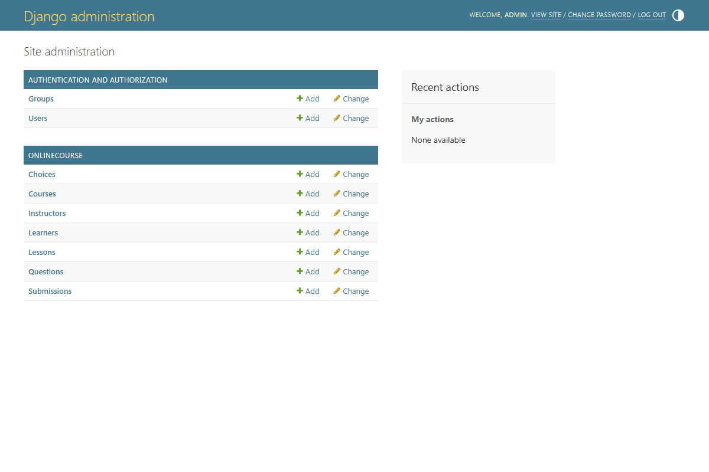
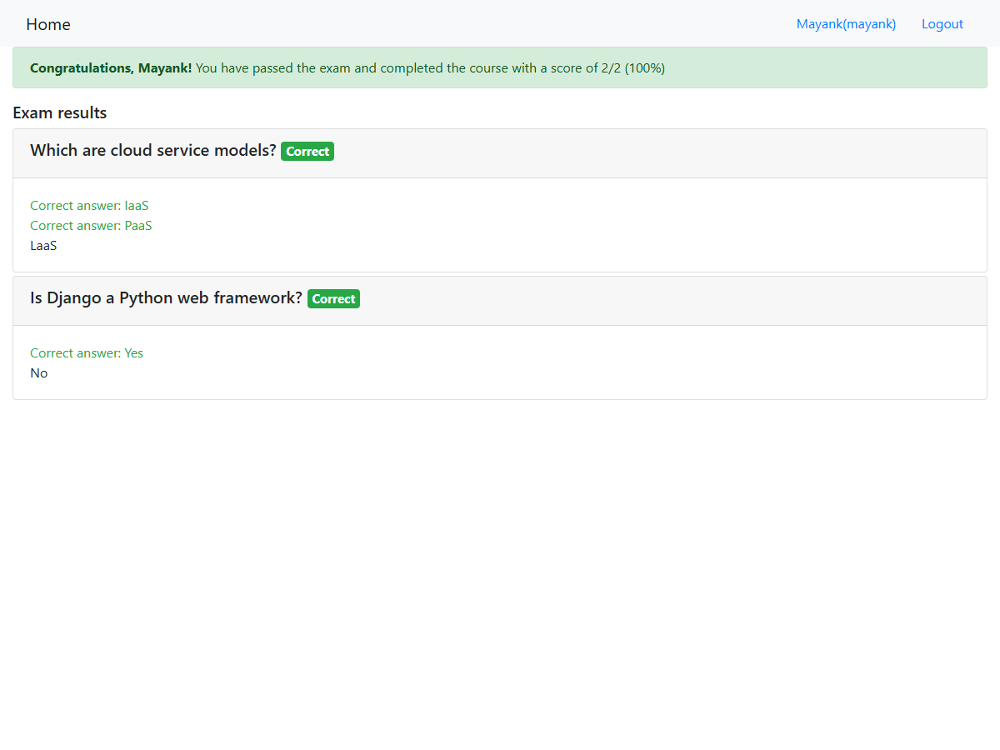

# Final Project Submission Proof - Online Course App (Exam Feature)

Screenshots and file links for the "Add a New Assessment Feature to an Online Course App" final project.

| Task | Proof |
|------|-------|
| 1 models.py (Question, Choice, Submission) | [onlinecourse/models.py](../onlinecourse/models.py) |
| 2 admin.py (7 imports, QuestionInline, ChoiceInline, QuestionAdmin, LessonAdmin) | [onlinecourse/admin.py](../onlinecourse/admin.py) |
| 3 Admin site screenshot | `03-admin-site.png` |
| 4 Course detail template | [onlinecourse/templates/onlinecourse/course_details_bootstrap.html](../onlinecourse/templates/onlinecourse/course_details_bootstrap.html) |
| 5 views.py (submit, show_exam_result) | [onlinecourse/views.py](../onlinecourse/views.py) |
| 6 urls.py (submit, show_exam_result paths) | [onlinecourse/urls.py](../onlinecourse/urls.py) |
| 7 Mock exam result screenshot | `07-final.png` |

